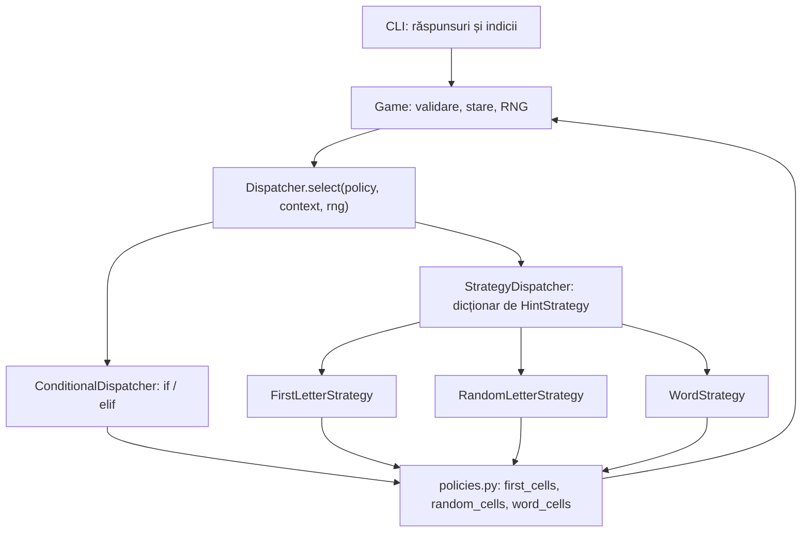
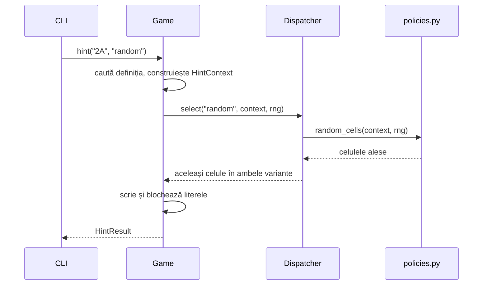

# Arhitectura

`Game` ține grila, literele scrise, celulele blocate, contorul de indicii și
generatorul `Random`. Pentru un indiciu, construiește un `HintContext` cu celulele
nerezolvate ale cuvântului și cere unui dispatcher să aleagă celulele de dezvăluit.
Apoi scrie literele, le blochează și crește contorul. Dispatcherul este singura
piesă care diferă între variante.

O definiție sau o politică necunoscută oprește apelul înainte să se atingă starea
sau generatorul aleator. `Puzzle` verifică la creare că grila e dreptunghiulară,
că definițiile sunt unice, că acoperă toate cuvintele de cel puțin două litere
și că nu rămâne nicio celulă fără definiție. Literele din intersecții există o
singură dată, în `Game.letters`.

Diagrama principală apare și în prezentare, desenată cu forme PowerPoint editabile.
