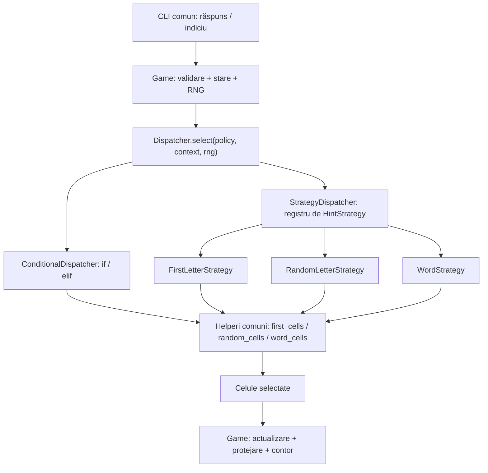

# Arhitectură și variante



`Game` este contextul aplicației și depinde de un Protocol `Dispatcher`.
În varianta Strategy, selecția după cheia primită de la client aparține
dispatcherului; obiectul concret satisface Protocol-ul `HintStrategy`.
Registrul este creat o dată per joc, strategiile sunt fără stare.
Algoritmul poate fi înlocuit fără schimbarea motorului. În baseline, același
contract public este implementat prin `if/elif`, fără cod redundant.

```mermaid
sequenceDiagram
    participant Client as CLI
    participant Game
    participant Dispatch as Dispatcher
    participant Policy as Helper comun
    Client->>Game: hint("2A", "random")
    Game->>Game: validează definiția; construiește HintContext
    Game->>Dispatch: select(policy, context, rng)
    Dispatch->>Policy: random_cells(context, rng)
    Policy-->>Dispatch: celule selectate
    Dispatch-->>Game: aceleași celule în ambele variante
    Game->>Game: scrie soluția, protejează, contor dacă există delta
    Game-->>Client: HintResult
```

Politica necunoscută este respinsă înainte de folosirea RNG/mutarea stării.
Cu definiție necunoscută, validarea se oprește înainte de dispatch. Grila este
validată structural: definiții unice, toate secvențele orizontale/verticale
de minimum două celule, fără celule neacoperite. Toate literele de la o
intersecție au o singură sursă de adevăr în `Game.letters`.

Diagramele principale sunt și **forme vizibile/editabile în PPTX**, nu
dependente de randarea Mermaid.
